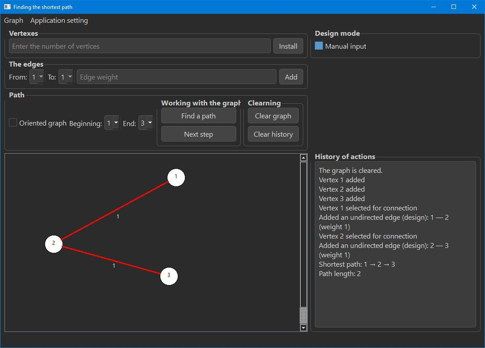

# Qt Shortest Path

Desktop application for finding the shortest path in a weighted graph using Dijkstra's algorithm. Graduation project (diploma), C++ / Qt.

Десктопное приложение для поиска кратчайшего пути во взвешенном графе алгоритмом Дейкстры. Дипломный проект, C++ / Qt.

## Возможности

- Построение графа: вершины и веса рёбер задаёт пользователь
- Выбор начальной и конечной вершин кликом по графу
- Поиск кратчайшего пути алгоритмом Дейкстры
- Пошаговый режим: можно проследить, как работает алгоритм
- Светлая и тёмная темы оформления
- Интерфейс на русском и английском языках

## Технологии

- C++
- Qt 6 (Widgets, Qt Designer, Qt Linguist), сборка через qmake

## Сборка и запуск

1. Установите Qt 6 и Qt Creator
2. Клонируйте репозиторий:
   `git clone https://github.com/NotFuzy/qt-shortest-path.git`
3. Откройте файл `QtShortestPath.pro` в Qt Creator
4. Выберите комплект (Kit) и нажмите Run

## Структура проекта

- `graph.*` — модель графа
- `dijkstra.*` — реализация алгоритма Дейкстры
- `dijkstrastepper.*` — пошаговое выполнение алгоритма
- `clickablescene.*` — сцена для отрисовки графа и выбора вершин
- `mainwindow.*` — главное окно и интерфейс
- `light.qss`, `dark.qss` — стили тем
- `app_ru.ts`, `app_en.ts` — файлы переводов

## Лицензия

MIT
